# Arquitectura del cliente

### M08-B · zona rural independiente (local, pendiente de aceptación)

`ZoneManager.travel` aplica sólo la sesión de zonas y conserva copias de poses; `main` comprueba modo/proximidad/seguridad y aplica la pose tras limpiar entradas. `Exploration.heightAt` permite navegación específica sin sustituir colisiones del lago. `village-layout.js` comparte huellas/altura entre mallas y navegación. `VillageView` se crea una vez y se cachea: sólo la escena activa se renderiza con el renderer/cámara existentes. El entorno sigue avanzando en aldea mientras la escuela de peces queda pausada en memoria. Vegetación comparte materiales y texturas, con geometrías clonadas para atributos de instancias independientes. No nuevos guardados, dependencias, interiores o economía; detalles y límites en [M08](../milestones/M08-anglers-village/design.md). Las secciones M07 inferiores son históricas.

El documento HTML proporciona el canvas y los diálogos. `src/main.js` inicializa el juego, la escena, la entrada y el audio; restaura las capturas y proyecta los eventos de dominio al DOM. La simulación recibe tiempo y aleatoriedad inyectables. `FishingGame` posee el estado de la jornada, las capturas y la referencia al pez enganchado. `FishSchool` actualiza agentes individuales. `LakeWorld` consume esos datos y mantiene recursos GPU, cámara, caña y efectos. El intervalo se subdivide al simular; una pausa sigue permitiendo presentar la escena. Un delta superior a 250 ms pierde tiempo simulado.

El audio crea su contexto tras interacción. La vista reutiliza geometrías y materiales para peces y trofeos. El generador PMREM se libera tras inicializar; `GameControls.dispose` retira sus listeners. La vida normal de la escena coincide con la de la página. La estabilidad tras sesiones largas o recreaciones necesita medición.

El diario conserva `alba-catches-v1`, un array JSON con nombre, peso, longitud y fecha. La migración valida los campos mínimos, normaliza el señuelo y las condiciones antiguas y filtra registros inválidos. El récord desempata por longitud. `alba-equipment-v1` almacena el identificador de cebo; `alba-audio-v1` conserva la preferencia de sonido. La hora y el clima reinician con la sesión.

[Inventario de módulos y dependencias](MODULES.md) · [Matriz de requisitos](../quality/TRACEABILITY.md)

### First Steps D · preparación de zonas

`zones.js` registra ID, entrada por defecto, apariciones (posición/yaw/pitch) y salidas `{zoneId, entryId}`. `main` crea `ZoneManager` con `world.scene` existente, sin sustituir renderer ni aplicar posiciones. Lago Sereno conserva su muelle y tiene salidas vacías. `prepareExit(id)` devuelve un plan copiado y validado o `null` si no existe salida; una configuración de destino inválida produce error. El plan no cambia la zona activa ni toca escena/jugador. La carga/aplicación/efectos visuales quedan para una etapa futura, no implementados. Sin persistencia de zona ni trabajo por frame. [Diseño M07](../milestones/M07-first-steps/design.md).

### First Steps · Etapa A en desarrollo

`Exploration` conserva posición, velocidad y modo sin depender del renderer; `ExplorationControls` traduce WASD, V, ratón y joystick. `main.js` aplica la posición a la cámara y suaviza su altura. `GameControls` conserva las acciones de pesca, bloqueadas durante exploración; `LakeWorld.look` conserva sus límites originales al pescar y amplía la vista sólo al explorar. Pointer Lock es opcional en PC y no se utiliza en modo pesca. El rectángulo seguro del muelle evita agua, postes y cuerdas; no hay navegación por terreno ni acceso a orillas. La posición no se persiste. [Diseño y límites de M07](../milestones/M07-first-steps/design.md).

**Etapa B, pendiente de validación del propietario:** `shore-route.js` amplía el rectángulo a una franja de tierra y sendero con altura compartida con la malla de `landscape.js`. `terrain-height.js` centraliza las funciones de relieve existentes sin cambiar su contrato público. El suelo se consulta analíticamente; los raycasts sólo existen en las pruebas. Se despejan obstáculos del corredor al generar el paisaje. Dos calas amplían los puestos del muelle: `FishingGame.setOrigin` parametriza exclusivamente las coordenadas de lanzamiento, recogida y objetivo de combate, y la cámara limita la mirada respecto del puesto. No se cambia IA ni persistencia.

### Contexto

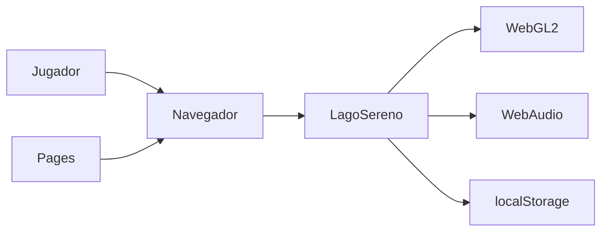

### Dependencias principales

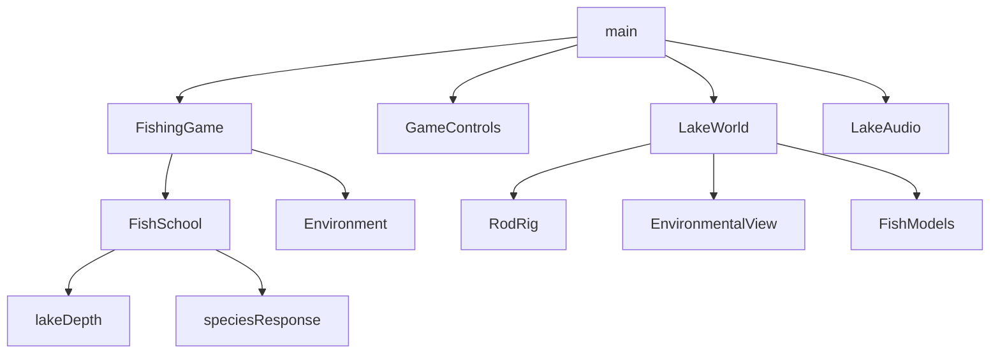

### Fotograma

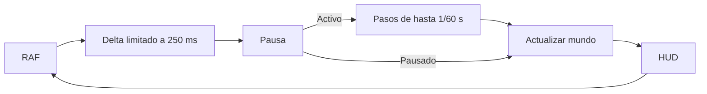

### Pesca

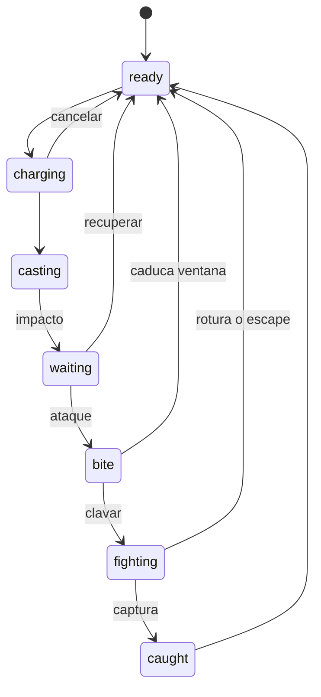

### Pez individual, rutas principales

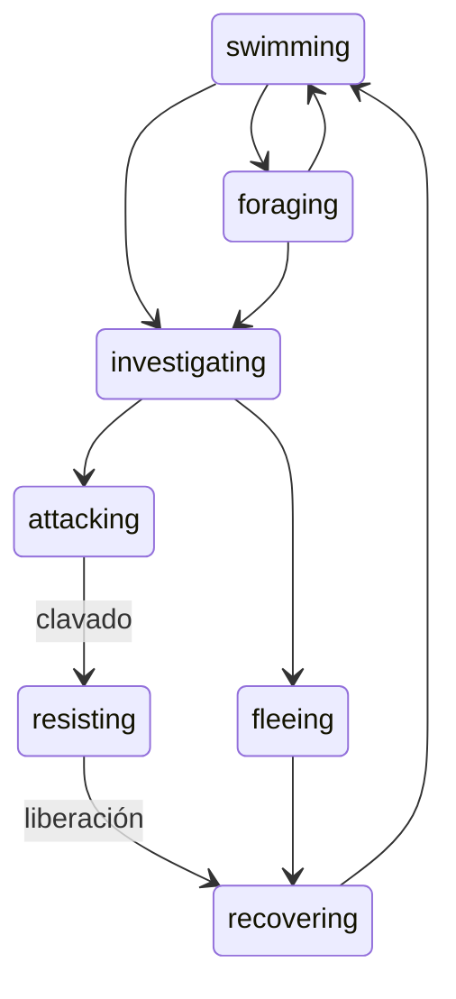

### Lanzamiento y captura

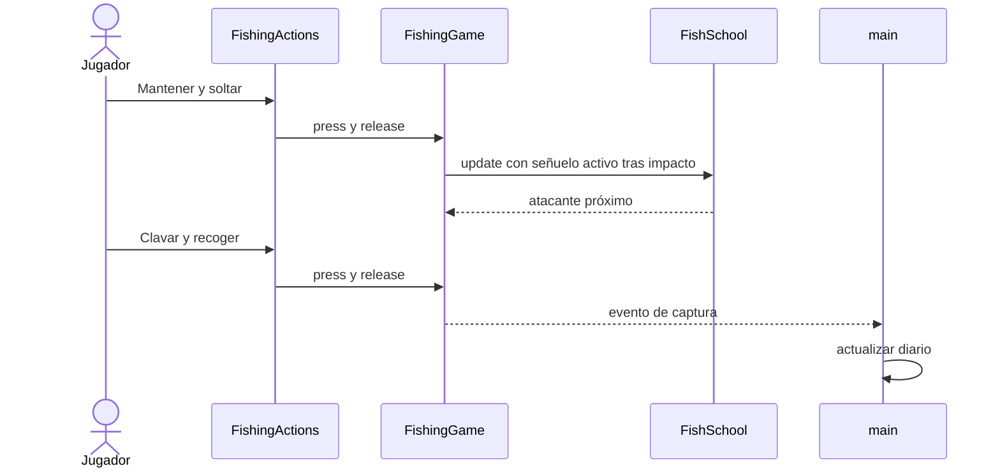

### Entrada

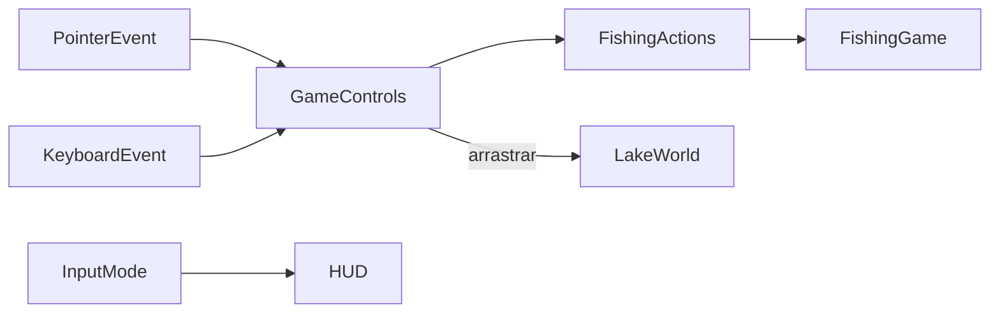

### Simulación y presentación

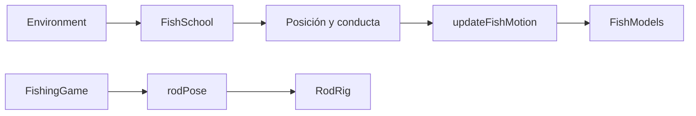

### Clima

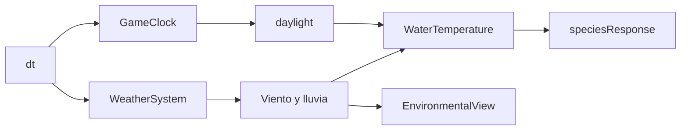

### Persistencia

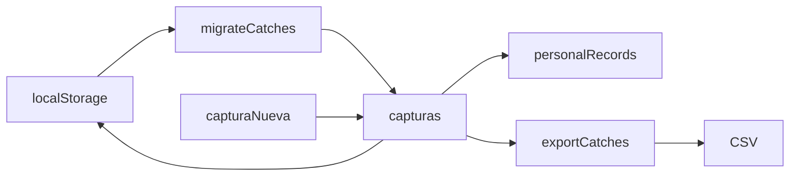

### Distribución

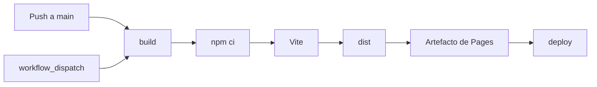
