# Arquitectura del cliente

**Shared M10 inhabitants:** `dialogues/conversation.js` extracts the accepted node/session and safe-proximity logic; Manuel retains its authored nodes and compatibility class wrapper. Shopkeeper identity/content live in `dialogues/shopkeeper.js`, with one editable display name. Main owns a small character registry, one panel, one active session and an allowlisted existing-shop action. Native close completes before the shop opens; only the owning modal clears pause, so there is no nested dialog or simulation frame in the handoff. The existing sign factory is parameterized, with shared joinery/paper/peg geometry and bubble map; Manuel defaults and appearance remain stable.

**Manuel sign presentation:** `visuals/manuel-sign.js` builds beveled instanced joinery using the existing village wood material, two correctly oriented paper/portrait faces sharing textures/geometries, and a depth-tested Sprite billboard. The sign stays inside the bench collision guard; no navigation changes. `VillageView` owns the cached presentation; main passes only the existing modal-pause boolean. The pure marker function bounds range/opacity/size/bob and reuses an output object per update. No narrative/input/save modifications.

### M10-C - integrated narrative presentation

`dialogues/manuel.js` separates pure narrative/proximity logic from DOM/Three.js. `main.js` supplies the unchanged B panel with conversation data and existing Environment observations. Contextual E beside the plaza bench precedes equipment; the existing mobile context button remains shared with shop/travel. Native modal plus clearHeld/paused freezes simulation, clears both sticks and releases Pointer Lock; close clears inputs and resumes. No narrative save keys or gameplay effects. The isolated DEV preview remains optional and is never imported by the game. Older B-only/planning sections below are historical.

### M10-B · presentación implementada, aislada del juego

`ui/dialogue-panel.js`/`.css` forman un panel DOM reutilizable por datos de identidad, retrato, texto y opciones/callbacks; modal nativo y selectores encapsulados, sin grafo de conversación ni estado de progreso. Foco inicial visible, cierre/Esc y restauración de foco, aviso de scroll por eventos/ResizeObserver, fallback de imagen y dispose del observador. Entrada independiente `dialogue-preview.html` → `previews/dialogue-preview.js`, protegida para desarrollo, sin import desde main/index ni nueva entrada de build. WebP independientes en public se cargan al abrir; Vite los copia a dist, pero la experiencia jugable no los solicita. No se conectan todavía proximidad, pausa ni controles del juego. [Diseño/evidencia](../milestones/M10-stories-of-the-village/design.md). La planificación inferior del grafo/interacción sigue sin implementar.

### M10 · planificación de conversación 2D (no implementada)

La [Etapa A de Stories of the Village](../milestones/M10-stories-of-the-village/design.md) propone un grafo local de diálogo y un panel HTML/CSS con WebP independientes, sin sistema de NPC 3D. Reutilizar pausa/modal/limpieza de entradas y proximidad contextual de la aldea, preservando tienda, viaje, mapa, ambos joysticks y controles PC. No persistir elecciones ni modificar contratos de progreso en este MVP. Los módulos nuevos sólo se planifican; el inventario de módulos implementados no cambia. B–E requieren autorización posterior.

### Ajuste menor de navegación posterior a v0.8.0

`input/camera-stick.js` es un adaptador de entrada táctil: captura propia, deadzone radial, velocidad proporcional y amortiguación exponencial integrada por tiempo, sin asignaciones por frame. Llama a `world.look` y conserva sus límites. ExplorationControls actualiza el adaptador antes del movimiento y separa la liberación del dedo izquierdo de la limpieza global: cada joystick cancela sólo su captura; menús, resize, blur y modo de entrada limpian ambos. CSS común conserva aspecto/medidas del izquierdo; derecho simétrico al explorar y separado de acción/HUD al pescar. No cambia Pointer Lock, sensibilidad PC, escenas ni guardados.

`input/exploration.js` conserva colisión horizontal a subpasos y añade impulso/gravedad relativos al suelo: sólo explora, sin doble salto, y prohíbe equipar en el aire. `main.js` aplica altura a cámara y requiere suelo al viajar. `zone-map.js` presenta Canvas 2D al abrir modal pausado, derivando agua/puestos/caminos/casas/salidas de los módulos existentes, sin simulación nueva ni cambios de guardado. M abre/cierra mapa, N conserva sonido, Espacio se enruta a salto o pesca según modo. [Contrato y evidencia](../milestones/M09-living-village/navigation-0.8.1.md).

### M09-E · horizonte rural

`visuals/village-horizon.js` genera una malla de colinas lejanas y dos lotes de arbolado distante, sólo dentro de `VillageView`. Reutiliza mapa de suelo, materiales/atlas arbóreos y niebla/luz de la escena rural; geometrías y buffers de instancias propios. La calidad reduce conteos por el bucle de plantas existente; no modifica árboles actuales, suelo transitable, escenas del lago ni navegación. Sin nueva simulación/persistencia; [diseño/evidencia M09](../milestones/M09-living-village/design.md).

### M09-E · pulido visual acotado

`village-ground.js` añade variación determinista de árboles y ruido continuo del mapa de suelo; `VillageView` conserva lotes y recursos, con proporciones/copas menos repetidas y sotobosque por manchas. Sólo árboles exteriores pueden cambiar de anclaje visual y permanecen fuera de navegación; huellas y alturas transitables intactas. Variación adicional del suelo exterior y ajustes menores del adaptador atmosférico D, sin nuevas mecánicas ni trabajo CPU por frame para vegetación. [Diseño M09](../milestones/M09-living-village/design.md).

### M09-D · atmósfera y humedad rural

`visuals/village-atmosphere.js` adapta la presentación Living Waters ya calculada, sin modificarla: luz/reflexión, niebla limitada y contraste de sombras PCFSoft existentes. `VillageView.update` recibe el entorno desde `world.js` y actualiza una humedad uniforme compartida según lluvia/tiempo simulado, con entrada y secado exponenciales; no añade mapas/mallas/pases ni cambia guardados. Un wrapper preserva hooks C al humedecer piedra, madera, teja y suelo, con brillo acotado. La paleta atlántica se conserva; no existe simulación estacional nueva. [Diseño M09](../milestones/M09-living-village/design.md).

### M09-C · materiales rurales

`visuals/village-materials.js` genera muestras deterministas para mapas propios al crear `VillageView` y adapta sólo materiales existentes: color/bump a escala métrica, variación de rugosidad y desgaste localizado por posición. Un mapa adicional para piedra labrada; tejas mantienen UV locales. Sin nuevas mallas/instancias, actualizaciones CPU por frame, contratos de navegación/interacción o cambios persistentes. [Diseño M09](../milestones/M09-living-village/design.md).

### M09-B · presentación de terreno y vegetación rural

`visuals/village-ground.js` calcula mezcla de caminos, exclusiones de plantas y altura exterior visual; conserva exactamente `villageHeight` en el rectángulo transitable. `village-layout.js`, límites, colisiones e interacciones no cambian. `VillageView` mantiene la escena y objetos actuales; dos lotes de robles/castaños reutilizan tarjetas y viento existentes con texturas propias, helechos curvos y hierba por manchas. 38 árboles en posiciones existentes, 720 grupos de hierba y 80 helechos, con reducción del 40% de sotobosque en móvil/baja. Sin nuevos sistemas ni persistencia; [diseño/evidencia M09](../milestones/M09-living-village/design.md).

### M08-D · selección y montaje persistentes

El mismo documento alba-village-progress-v1 incorpora esquema interno 2 con `equipment` (lureId, lineId, lineUnit). Leer esquema C 1 adapta en memoria sin regalar crédito ni tocar cantidades/recibos; el siguiente cambio confirmado persiste todo el candidato. `VillageShop.equip` valida propiedad/unidad y guarda antes de aplicar. `main.equipItem` comparte esta acción entre ShopPanel y Equipo y utiliza FishingGame.selectLure después del guardado; monta unidades del monofilamento existente sin cambiar resistencia/stock. Inicio restaura equipo del documento nuevo; alba-equipment-v1 queda como espejo legado. Fallo de escritura mantiene equipo anterior; progreso comercial ilegible se preserva sin impedir la pesca compatible. Capturas/audio y otros guardados conservan sus claves y formatos. [Diseño/evidencia M08](../milestones/M08-anglers-village/design.md).

### M08-C · comercio local

`VillageShop` separa catálogo/compras del renderer y guarda saldo, cantidades y recibos juntos en `alba-village-progress-v1` antes de aplicar cada compra. Preserva claves de capturas, selección y audio. Datos inválidos/inaccesibles bloquean comercio; fallo de compra no consume saldo. `ShopPanel` presenta catálogo modal, bloquea doble activación y usa `FishingGame.selectLure` existente; Equipo muestra cantidades/saldo. `main` despacha una sola acción T/botón según cercanía (puerta de tienda o salida), limpia entradas al abrir modal y actualiza encabezado por zona. Sin cambiar mecánicas, estadísticas, consumo ni modelos; inventario comercial agrega reservas al equipo inicial. [Diseño M08](../milestones/M08-anglers-village/design.md).

### M08-B · zona rural independiente (local, pendiente de aceptación)

`ZoneManager.travel` aplica sólo la sesión de zonas y conserva copias de poses; `main` comprueba modo/proximidad/seguridad y aplica la pose tras limpiar entradas. `Exploration.heightAt` permite navegación específica sin sustituir colisiones del lago. `village-layout.js` comparte huellas/altura entre mallas y navegación. `VillageView` se crea una vez y se cachea: sólo la escena activa se renderiza con el renderer/cámara existentes. El entorno sigue avanzando en aldea mientras la escuela de peces queda pausada en memoria. Vegetación comparte materiales y texturas, con geometrías clonadas para atributos de instancias independientes. No nuevos guardados, dependencias, interiores o economía; detalles y límites en [M08](../milestones/M08-anglers-village/design.md). Las secciones M07 inferiores son históricas.

El documento HTML proporciona el canvas y los diálogos. `src/main.js` inicializa el juego, la escena, la entrada y el audio; restaura las capturas y proyecta los eventos de dominio al DOM. La simulación recibe tiempo y aleatoriedad inyectables. `FishingGame` posee el estado de la jornada, las capturas y la referencia al pez enganchado. `FishSchool` actualiza agentes individuales. `LakeWorld` consume esos datos y mantiene recursos GPU, cámara, caña y efectos. El intervalo se subdivide al simular; una pausa sigue permitiendo presentar la escena. Un delta superior a 250 ms pierde tiempo simulado.

El audio crea su contexto tras interacción. La vista reutiliza geometrías y materiales para peces y trofeos. El generador PMREM se libera tras inicializar; `GameControls.dispose` retira sus listeners. La vida normal de la escena coincide con la de la página. La estabilidad tras sesiones largas o recreaciones necesita medición.

El diario conserva `alba-catches-v1`, un array JSON con nombre, peso, longitud y fecha. La migración valida los campos mínimos, normaliza el señuelo y las condiciones antiguas y filtra registros inválidos. El récord desempata por longitud. `alba-equipment-v1` almacena el identificador de cebo; `alba-audio-v1` conserva la preferencia de sonido. La hora y el clima reinician con la sesión.

[Inventario de módulos y dependencias](MODULES.md) · [Matriz de requisitos](../quality/TRACEABILITY.md)

### First Steps D · preparación de zonas

`zones.js` registra ID, entrada por defecto, apariciones (posición/yaw/pitch) y salidas `{zoneId, entryId}`. `main` crea `ZoneManager` con `world.scene` existente, sin sustituir renderer ni aplicar posiciones. Lago Sereno conserva su muelle y tiene salidas vacías. `prepareExit(id)` devuelve un plan copiado y validado o `null` si no existe salida; una configuración de destino inválida produce error. El plan no cambia la zona activa ni toca escena/jugador. La carga/aplicación/efectos visuales quedan para una etapa futura, no implementados. Sin persistencia de zona ni trabajo por frame. [Diseño M07](../milestones/M07-first-steps/design.md).

### First Steps · Etapa A en desarrollo

`Exploration` conserva posición, velocidad y modo sin depender del renderer; `ExplorationControls` traduce WASD, V, ratón y joystick. `main.js` aplica la posición a la cámara y suaviza su altura. `GameControls` conserva las acciones de pesca, bloqueadas durante exploración; `LakeWorld.look` conserva sus límites originales al pescar y amplía la vista sólo al explorar. Pointer Lock es opcional en PC y no se utiliza en modo pesca. El rectángulo seguro del muelle evita agua, postes y cuerdas; no hay navegación por terreno ni acceso a orillas. La posición no se persiste. [Diseño y límites de M07](../milestones/M07-first-steps/design.md).

**Etapa B, pendiente de validación del propietario:** `shore-route.js` amplía el rectángulo a una franja de tierra y sendero con altura compartida con la malla de `landscape.js`. `terrain-height.js` centraliza las funciones de relieve existentes sin cambiar su contrato público. El suelo se consulta analíticamente; los raycasts sólo existen en las pruebas. Se despejan obstáculos del corredor al generar el paisaje. Dos calas amplían los puestos del muelle: `FishingGame.setOrigin` parametriza exclusivamente las coordenadas de lanzamiento, recogida y objetivo de combate, y la cámara limita la mirada respecto del puesto. No se cambia IA ni persistencia.

### Contexto

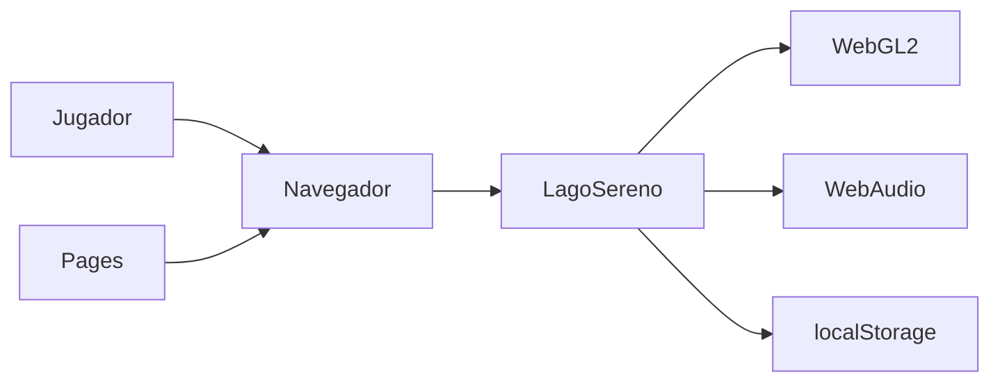

### Dependencias principales

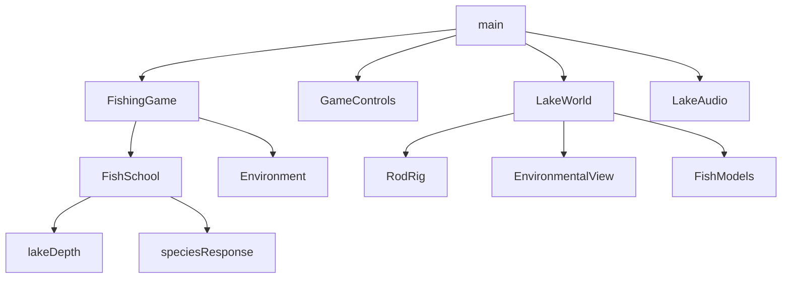

### Fotograma

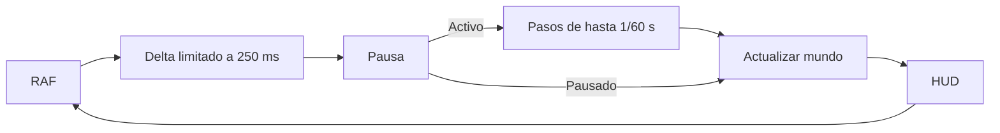

### Pesca

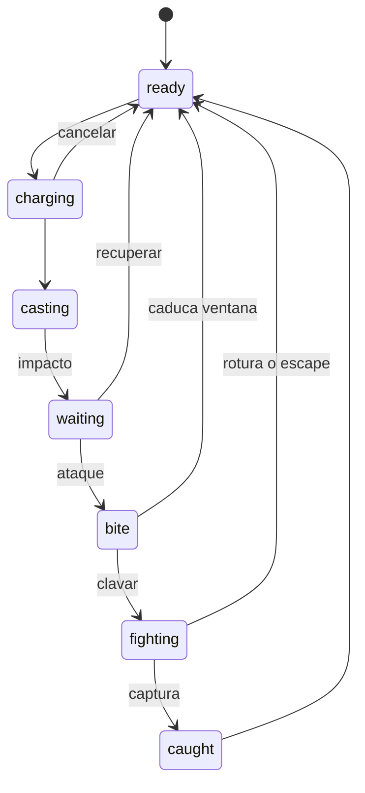

### Pez individual, rutas principales

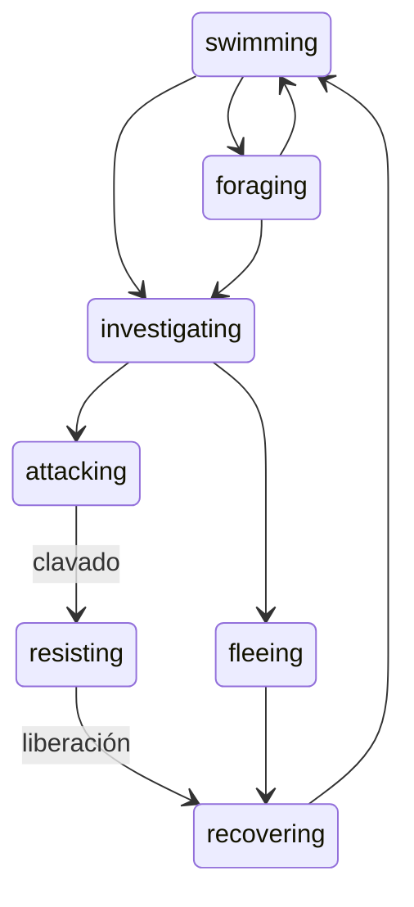

### Lanzamiento y captura

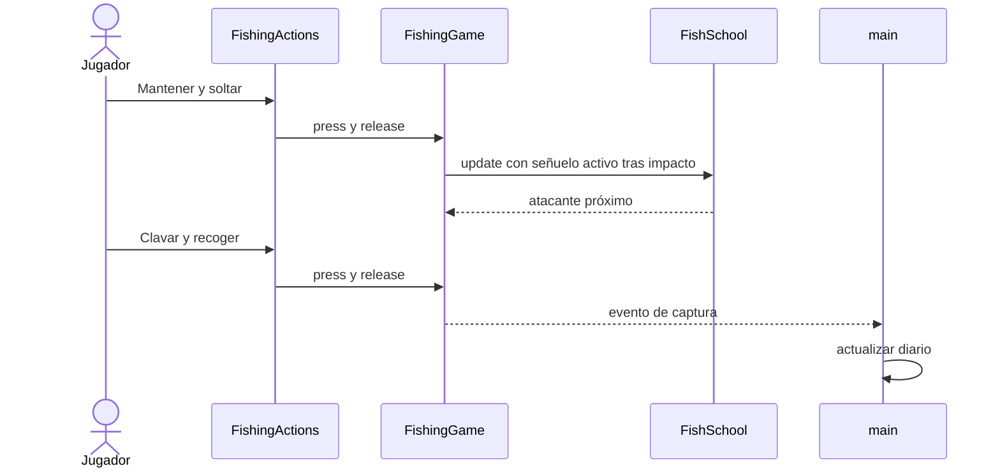

### Entrada

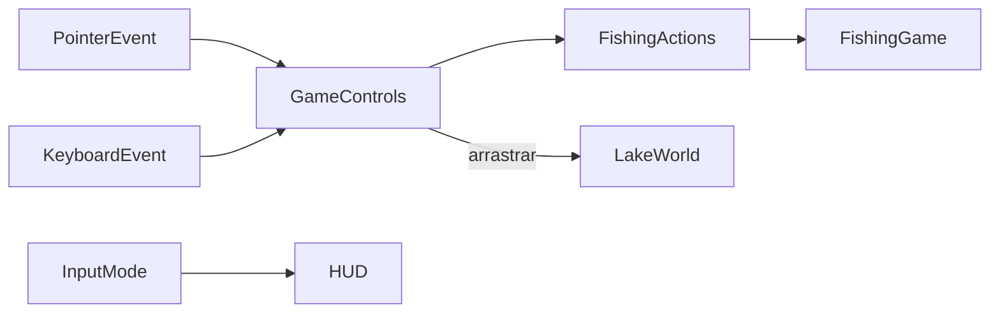

### Simulación y presentación

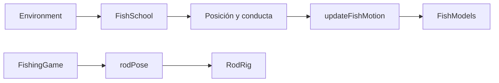

### Clima

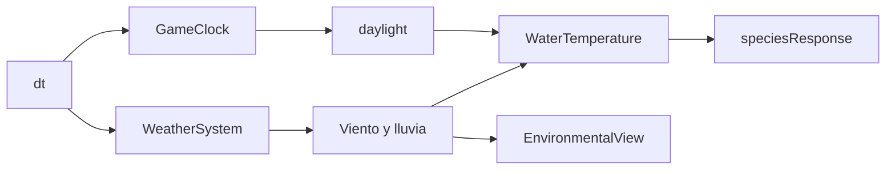

### Persistencia

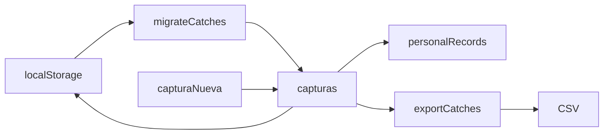

### Distribución

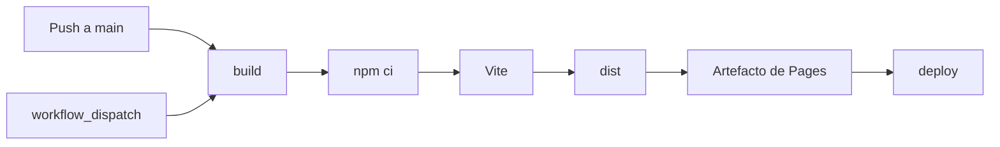
