# Arquitectura del cliente

El documento HTML proporciona el canvas y los diálogos. `src/main.js` inicializa el juego, la escena, la entrada y el audio; restaura las capturas y proyecta los eventos de dominio al DOM. La simulación recibe tiempo y aleatoriedad inyectables. `FishingGame` posee el estado de la jornada, las capturas y la referencia al pez enganchado. `FishSchool` actualiza agentes individuales. `LakeWorld` consume esos datos y mantiene recursos GPU, cámara, caña y efectos. El intervalo se subdivide al simular; una pausa sigue permitiendo presentar la escena. Un delta superior a 250 ms pierde tiempo simulado.

El audio crea su contexto tras interacción. La vista reutiliza geometrías y materiales para peces y trofeos. El generador PMREM se libera tras inicializar; `GameControls.dispose` retira sus listeners. La vida normal de la escena coincide con la de la página. La estabilidad tras sesiones largas o recreaciones necesita medición.

El diario conserva `alba-catches-v1`, un array JSON con nombre, peso, longitud y fecha. La migración valida los campos mínimos, normaliza el señuelo y las condiciones antiguas y filtra registros inválidos. El récord desempata por longitud. `alba-equipment-v1` almacena el identificador de cebo; `alba-audio-v1` conserva la preferencia de sonido. La hora y el clima reinician con la sesión.

[Inventario de módulos y dependencias](MODULES.md) · [Matriz de requisitos](../quality/TRACEABILITY.md)

### Contexto

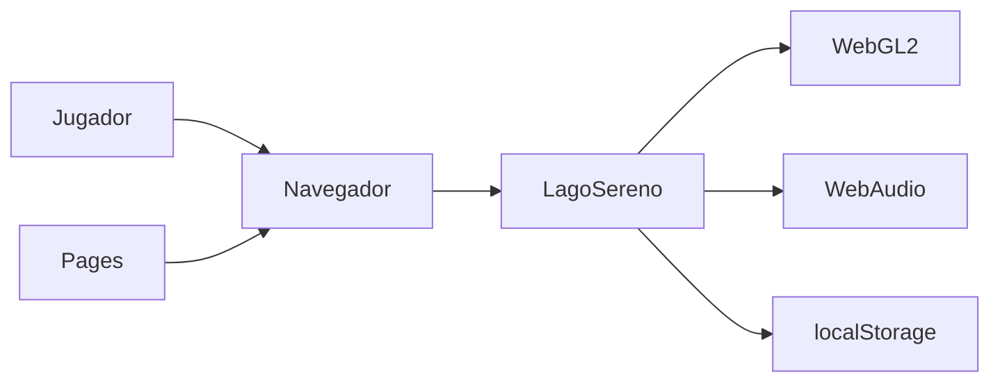

### Dependencias principales

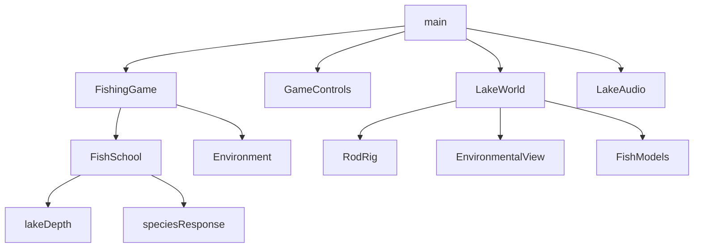

### Fotograma

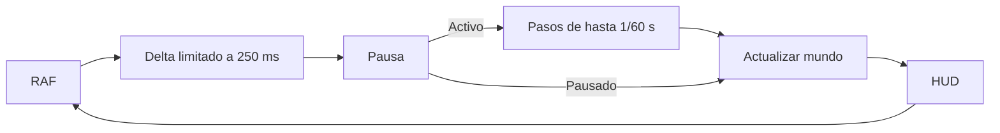

### Pesca

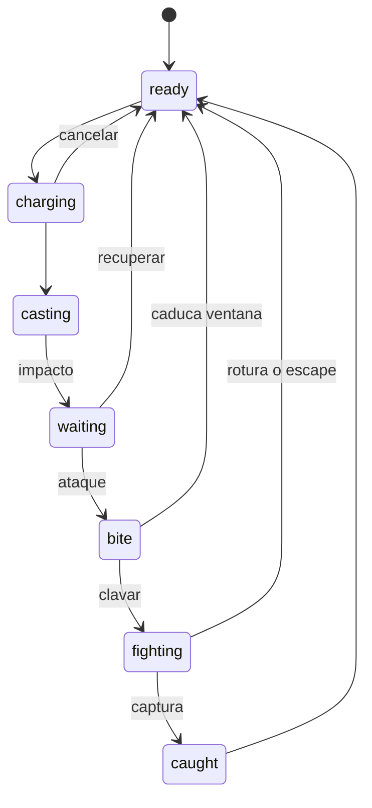

### Pez individual, rutas principales

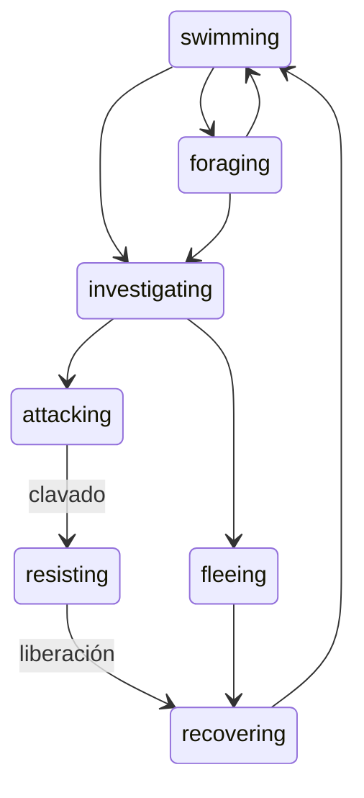

### Lanzamiento y captura

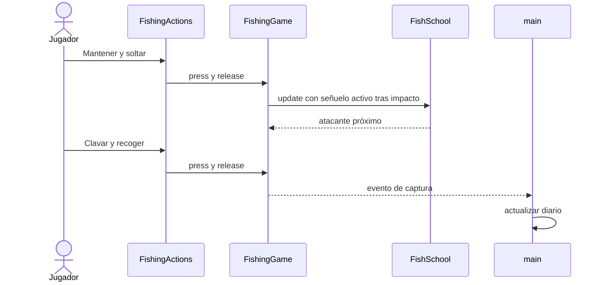

### Entrada

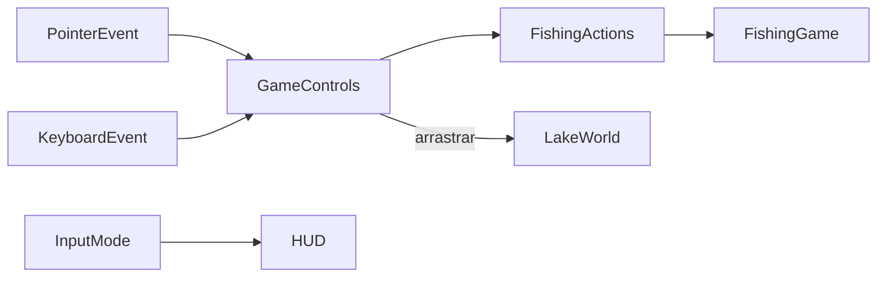

### Simulación y presentación

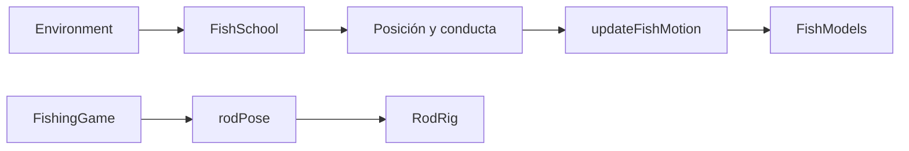

### Clima

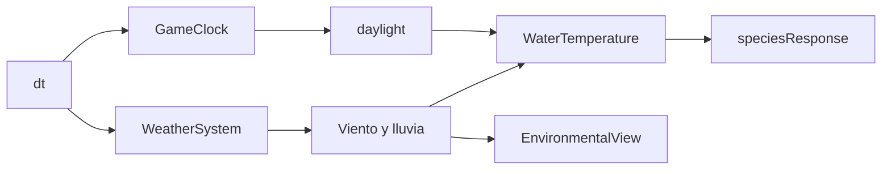

### Persistencia

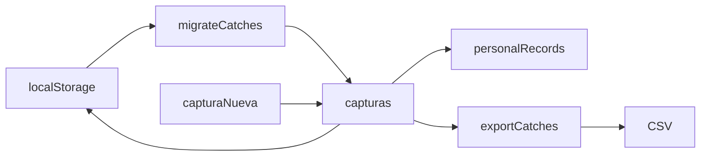

### Distribución

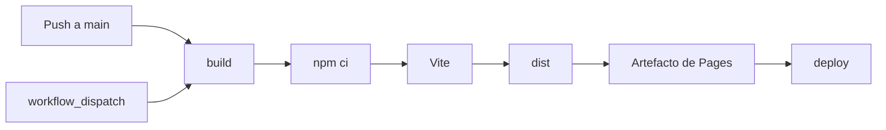
